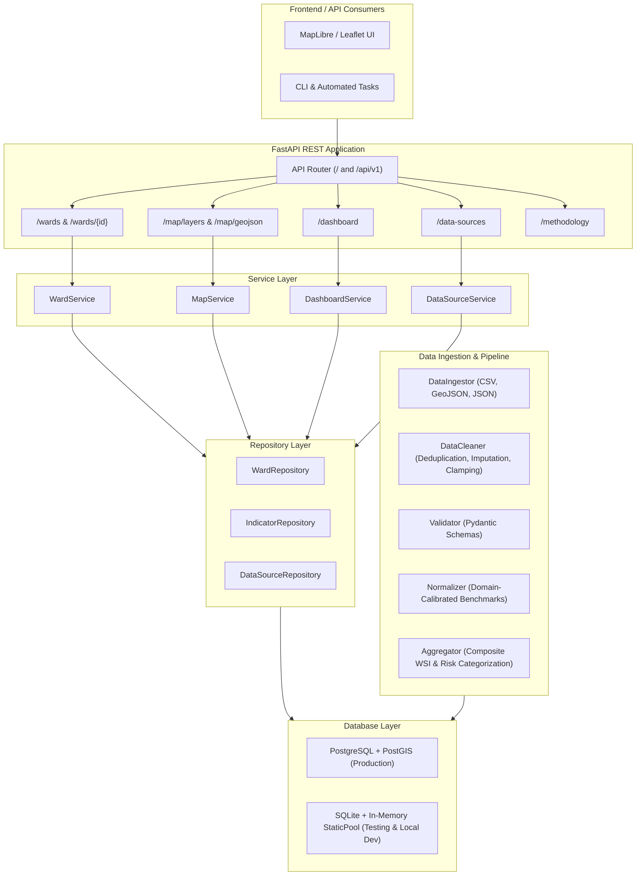

# 🏛️ WaterMap System Architecture

## Overview

**WaterMap** is designed with a decoupled, high-performance architecture built for urban water analytics, geospatial intelligence, and predictive stress modeling.

---

## 📐 Architecture Diagram

---

## 🧱 Architectural Layers

### 1. Presentation Layer (FastAPI REST API)
- Thin route controllers (`app/api/routes/`) validating input payloads via Pydantic schemas.
- Dual mounting at root (`/wards`, `/health`, `/map/layers`) and prefixed (`/api/v1/wards`, `/api/v1/predictions`).
- Clean separation of concerns with standard HTTP status codes:
  * `200 OK`: Successful retrieval.
  * `201 Created`: Successful resource creation.
  * `404 Not Found`: Unknown ward or data source.
  * `501 Not Implemented`: Reserved endpoints for Part 2.

### 2. Service Layer (`app/services/`)
- Encapsulates business logic, data assembly, and calculations.
- `WardService`: Retrieves ward profiles, handles filtering, and attaches indicator time-series.
- `MapService`: Prepares GeoJSON FeatureCollections, computes bounding boxes, and handles point-in-polygon lookups.
- `DashboardService`: Computes city-wide distributions, risk counts, and top critical wards.
- `DataSourceService`: Manages source registry and telemetry tracking.

### 3. Repository Layer (`app/repositories/`)
- Abstract database operations away from business logic.
- Implements flexible filtering, sorting, pagination, and bulk upsert operations.

### 4. Data Pipeline Engine (`app/data_pipeline/`)
- **Ingestion (`ingestion.py`)**: Streams and parses GeoJSON boundaries, sensor CSVs, and registry JSON.
- **Cleaning (`cleaning.py`)**: Sanitizes ward IDs (e.g. `w1` -> `W001`), clamps impossible values, and deduplicates records.
- **Validation (`validation.py`)**: Strict Pydantic contracts ensuring valid ranges for groundwater depth, rainfall departure, and water supply.
- **Normalization (`normalization.py`)**: Standardizes diverse physical units into a normalized 0.0 - 1.0 stress index based on national benchmarks.
- **Aggregation (`aggregation.py`)**: Computes weighted Water Stress Index (WSI) and risk classifications.

### 5. Storage Layer (PostgreSQL / PostGIS with SQLite fallback)
- **Production**: PostgreSQL 15+ with PostGIS extension for native spatial queries (`ST_Contains`, `ST_Area`).
- **Development & Testing**: Fully transparent fallback to SQLite (with in-memory `StaticPool`), ensuring 100% test pass rates without external daemon dependencies.
