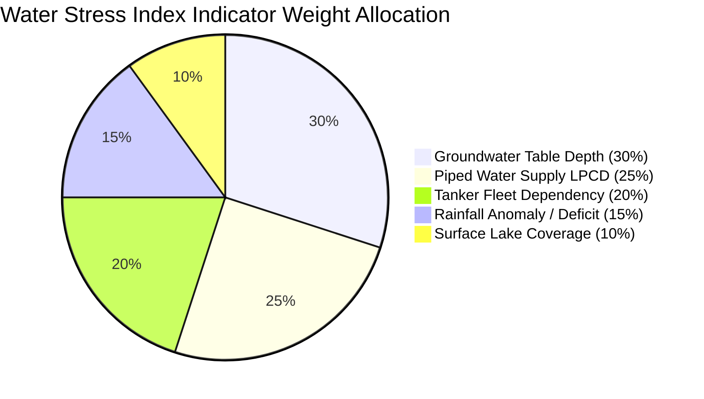

# 🔬 WaterMap Water Stress Index (WSI) Methodology

## 1. Executive Summary & Purpose

The **WaterMap Water Stress Index (WSI)** is a multi-dimensional, domain-calibrated analytical framework engineered to quantify, monitor, and predict localized water stress across urban municipal wards. By fusing hydrological ground-truth, piped infrastructure telemetry, citizen demand signals, meteorological anomalies, and surface water buffer capacity, the framework computes a standardized, continuous vulnerability metric ranging from `0.00` (optimal resilience) to `1.00` (acute crisis).

The index is specifically calibrated against statutory Indian standards, including the **Central Public Health and Environmental Engineering Organisation (CPHEEO)** urban water supply benchmarks, the **Central Ground Water Board (CGWB)** aquifer categorization guidelines, and the **India Meteorological Department (IMD)** drought anomaly scales.

---

## 2. Mathematical Formulation

The composite Water Stress Index for ward $w$ is defined as a weighted normalized summation of $n$ domain indicators:

$$WSI_w = \frac{\sum_{i=1}^{n} w_i \cdot s_{i,w}}{\sum_{i=1}^{n} w_i}$$

Where:
- $w_i \in (0, 1]$ represents the domain importance weight assigned to indicator $i$, satisfying $\sum_{i=1}^n w_i = 1.00$.
- $s_{i,w} \in [0.0, 1.0]$ represents the normalized stress score of indicator $i$ for ward $w$.
- A higher score $s_{i,w}$ denotes higher hydrological stress, deficit, or vulnerability.

If an unclassified or experimental indicator is supplied without an explicit weight configuration, the pipeline applies a conservative fallback weight $w_{\text{fallback}} = 0.10$.

---

## 3. Indicator Specifications & Normalization Functions

The framework incorporates five core pillar indicators, capturing subsurface, reticulated, informal, meteorological, and ecological dimensions of water security:

| Pillar | Indicator Name | Metric Key | Unit | Weight ($w_i$) | Authoritative Source |
| :--- | :--- | :--- | :--- | :--- | :--- |
| **Subsurface** | Groundwater Table Depth | `groundwater_depth_mbgl` | meters below ground level (`mbgl`) | **30%** (0.30) | CGWB National Water Informatics Centre (NWIC) |
| **Reticulated** | Piped Water Supply | `piped_water_supply_lpcd` | Litres per capita per day (`LPCD`) | **25%** (0.25) | Bangalore Water Supply and Sewerage Board (BWSSB) |
| **Informal** | Commercial Tanker Reliance | `tanker_dependency_index` | Trips per 1,000 population (`trips/k`) | **20%** (0.20) | BBMP Sahaaya 2.0 Grievance Redressal / Fleets |
| **Meteorological**| Rainfall Precipitation Anomaly | `rainfall_deficit_pct` | Departure % from Long-Period Average | **15%** (0.15) | India Meteorological Department (IMD) |
| **Ecological** | Surface Water & Lake Coverage | `water_body_coverage_pct` | Wetland area % of total ward area | **10%** (0.10) | Karnataka State Remote Sensing Centre (KSRSAC) |

---

### 3.1. Groundwater Table Depth ($s_{\text{gw}}$)
- **Weight**: `0.30`
- **Unit**: Meters Below Ground Level (`mbgl`)
- **Domain Rationale**: Over-extraction of confined and unconfined aquifers leads to borewell failure, land subsidence, and saline/fluoride contamination. CGWB classifies static water tables $>45\text{ mbgl}$ as critically over-exploited in crystalline hard-rock aquifers.
- **Normalization Function**:
  Linear scaling capped at an extreme depletion threshold of $75.0\text{ mbgl}$:
  $$s_{\text{gw}} = \min\left(1.0, \max\left(0.0, \frac{\text{depth}_{\text{mbgl}}}{75.0}\right)\right)$$
- **Benchmarking Tiers**:
  - Safe: $< 10.0\text{ mbgl}$ ($s \le 0.133$)
  - Semi-Critical: $10.0 - 25.0\text{ mbgl}$ ($0.133 < s \le 0.333$)
  - Critical: $25.0 - 45.0\text{ mbgl}$ ($0.333 < s \le 0.600$)
  - Over-Exploited: $> 45.0\text{ mbgl}$ ($s > 0.600$)

---

### 3.2. Piped Water Supply ($s_{\text{pws}}$)
- **Weight**: `0.25`
- **Unit**: Litres Per Capita Per Day (`LPCD`)
- **Domain Rationale**: CPHEEO prescribes $135\text{ LPCD}$ as the statutory minimum benchmark for metropolitan cities with full sewerage networks. Supply dropping below $25\text{ LPCD}$ represents an emergency survival threshold.
- **Normalization Function**:
  Inverse scaling calibrated against the CPHEEO $135\text{ LPCD}$ benchmark:
  $$s_{\text{pws}} = \begin{cases} 0.0 & \text{if } \text{supply} \ge 135.0 \\ \min\left(1.0, \max\left(0.0, \frac{135.0 - \text{supply}}{110.0}\right)\right) & \text{if } \text{supply} < 135.0 \end{cases}$$
- **Benchmarking Tiers**:
  - Adequate / Benchmark Met: $\ge 135\text{ LPCD}$ ($s = 0.000$)
  - Stressed: $60.0 - 134.9\text{ LPCD}$ ($0.001 \le s < 0.682$)
  - Crisis / Emergency Deficit: $< 60.0\text{ LPCD}$ ($s \ge 0.682$)

---

### 3.3. Commercial Tanker Dependency ($s_{\text{tanker}}$)
- **Weight**: `0.20`
- **Unit**: Daily tanker deliveries per 1,000 residents (`trips/k`)
- **Domain Rationale**: Private water tanker deliveries are an immediate economic and logistical proxy for reticulated distribution failure and dry borewells. Grievance tickets for tanker requests surge exponentially during localized supply shocks.
- **Normalization Function**:
  Linear scaling calibrated to a severe dependency ceiling of $6.0\text{ trips/k}$:
  $$s_{\text{tanker}} = \min\left(1.0, \max\left(0.0, \frac{\text{trips}}{6.0}\right)\right)$$
- **Benchmarking Tiers**:
  - Low Dependency: $< 1.0\text{ trip/k}$ ($s < 0.167$)
  - Moderate Reliance: $1.0 - 3.0\text{ trips/k}$ ($0.167 \le s \le 0.500$)
  - Severe Informal Dependency: $> 3.0\text{ trips/k}$ ($s > 0.500$)

---

### 3.4. Rainfall Precipitation Anomaly ($s_{\text{rain}}$)
- **Weight**: `0.15`
- **Unit**: Percentage departure from historical normal ($\%$)
- **Domain Rationale**: Meteorological rainfall deficits prevent seasonal groundwater recharge and reservoir replenishment. IMD defines precipitation departures below $-20\%$ as deficient and below $-60\%$ as scanty/drought conditions.
- **Normalization Function**:
  Unilateral deficit scaling (surplus precipitation does not incur stress penalties):
  $$s_{\text{rain}} = \begin{cases} 0.0 & \text{if } \text{departure} \ge 0.0\% \\ \min\left(1.0, \max\left(0.0, \frac{|\text{departure}|}{60.0}\right)\right) & \text{if } \text{departure} < 0.0\% \end{cases}$$
- **Benchmarking Tiers**:
  - Normal / Surplus: $\ge -19.0\%$ ($s \le 0.317$)
  - Deficient: $-20.0\% \text{ to } -59.0\%$ ($0.333 \le s < 1.000$)
  - Scanty / Extreme Drought: $\le -60.0\%$ ($s = 1.000$)

---

### 3.5. Surface Water & Lake Coverage ($s_{\text{lake}}$)
- **Weight**: `0.10`
- **Unit**: Surface water area as percentage of ward total area ($\%$)
- **Domain Rationale**: Urban lakes act as sponge buffers, microclimate regulators, and primary percolation basins for surrounding shallow aquifers. Wards with $<1\%$ lake cover exhibit zero natural flood attenuation and rapid water table decline.
- **Normalization Function**:
  Inverse resilience scaling capped at an optimal ecological buffer of $5.0\%$ ward area:
  $$s_{\text{lake}} = \begin{cases} 0.0 & \text{if } \text{coverage} \ge 5.0\% \\ \min\left(1.0, \max\left(0.0, \frac{5.0 - \text{coverage}}{5.0}\right)\right) & \text{if } \text{coverage} < 5.0\% \end{cases}$$
- **Benchmarking Tiers**:
  - Resilient Buffer: $\ge 5.0\%$ ($s = 0.000$)
  - Vulnerable / Low Buffer: $1.0\% - 4.9\%$ ($0.020 \le s \le 0.800$)
  - Depleted / No Surface Water: $< 1.0\%$ ($s > 0.800$)

---

## 4. Risk Categorization Tiers

The continuous Water Stress Index ($0.000 \le WSI \le 1.000$) is discretized into four actionable operational risk categories:

| Risk Category | WSI Range | Color Code | Operational Status & Policy Interpretation |
| :--- | :--- | :--- | :--- |
| **Low** | $0.000 - 0.349$ | `#10B981` (Green) | **Resilient Baseline**. Piped water supplies meet or exceed CPHEEO benchmarks. Groundwater levels are within recharge thresholds. Minimal informal tanker reliance. |
| **Moderate** | $0.350 - 0.549$ | `#F59E0B` (Amber) | **Vulnerable / Watchlist**. Piped supply exhibits minor distribution deficits. Aquifers reflect seasonal decline. Citizen grievances remain manageable. |
| **High** | $0.550 - 0.749$ | `#EF4444` (Coral Red) | **Acute Stress / Elevated Threat**. Significant per capita piped shortfall ($<90\text{ LPCD}$). Severe commercial tanker reliance and groundwater tables exceeding $35\text{ mbgl}$. |
| **Critical** | $0.750 - 1.000$ | `#7F1D1D` (Crimson) | **Emergency Crisis**. Multi-system failure: depleted aquifers ($>50\text{ mbgl}$), acute piped deficit ($<50\text{ LPCD}$), high informal tanker exploitation. Immediate administrative intervention required. |

---

## 5. Data Ingestion, Cleaning & Quality Assurance

To guarantee mathematical stability and pipeline resilience, raw data streams are processed through strict pre-aggregation sanitization stages:

1. **Identifier Canonicalization**:
   - Ward identifiers are regex-matched and padded to four-character uppercase standard (`w1` $\to$ `W001`).
2. **Domain Boundary Clamping**:
   - Outliers beyond physical or operational possibilities are clamped to admissible ranges (e.g., groundwater depths clamped to $[0, 150]\text{ mbgl}$; percentage fields clamped to $[0, 100]\%$).
3. **Missing Value Imputation**:
   - Unreported indicator readings default to historical ward median or zonal baseline rather than introducing null propagation.
4. **Pydantic Type & Schema Enforcement**:
   - Every staged record is strictly validated against typed schemas (`WardValidationSchema`, `GroundwaterValidationSchema`, `WaterSupplyValidationSchema`) with rejected records logged to pipeline run diagnostics.
5. **Deduplication**:
   - Duplicate records for identical `(ward_id, metric, timestamp)` combinations are resolved using most-recent timestamp priority.

---

## 6. Forward Compatibility with Part 2 (Intelligence Layer)

The Part 1 data architecture and indicator registry directly support subsequent analytical capabilities:
- **Predictive Forecasting (`/api/v1/predictions`)**: Temporal indicator series provide the feature matrix for 30/60/90-day WSI forecasting.
- **Scenario Simulation (`/api/v1/simulations`)**: Normalized stress transfer functions allow real-time modeling of climate anomalies (e.g., $-40\%$ monsoon deficit) or infrastructure outages.
- **Decision Support (`/api/v1/recommendations`)**: Ward risk categorizations generate automated policy interventions (e.g., rainwater harvesting mandate, piped pressure equalization, tanker price caps).
